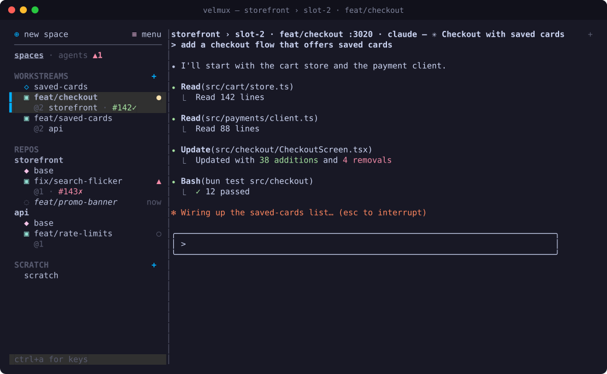
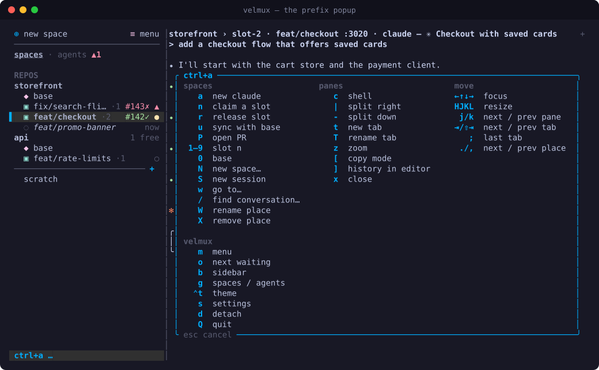
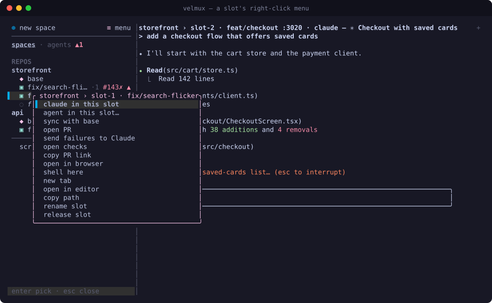
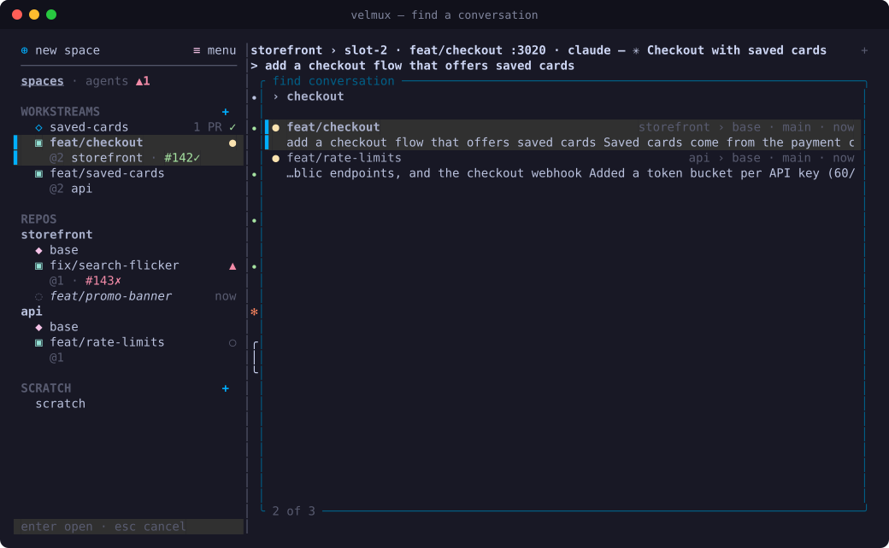
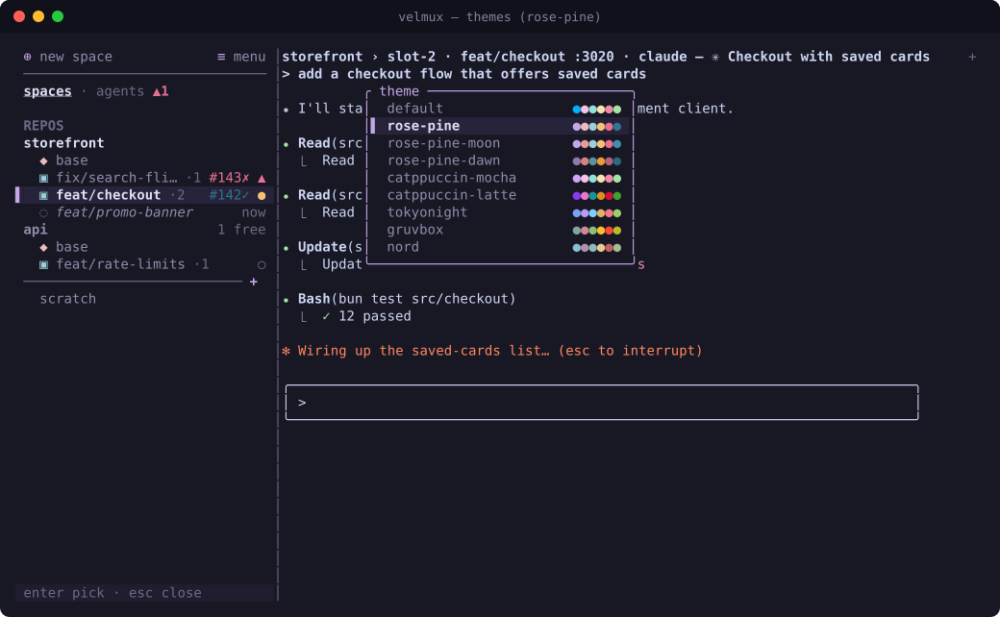

# velmux

Worktree **pools** for parallel agent work. Each repo's base checkout (the
"space") owns a fixed set of warm worktree slots — claimed for a workstream,
released back clean, never thrown away. Dependencies and build caches survive
release, so a claim is sub-second instead of a cold install.

```
~/Workspace/app                 ← base checkout (space)
~/Workspace/.pools/app/slot-1…5 ← pooled worktrees
```



| | |
|---|---|
|  |  |
|  |  |

## Setup

```sh
cargo install --path crates/velmux-cli   # or symlink target/release/velmux
velmux skill install                     # teach Claude to work in velmux
velmux keys --ghostty                    # Ghostty keybinds for the Cmd chords
cd ~/Workspace/app && velmux             # attach (starts the server)
```

`velmux skill install` writes a Claude Code skill to `~/.claude/skills/velmux/`
(`--project` puts it in the repo's `.claude/skills/` to commit instead): how to
tell it's in velmux (`$VELMUX_PANE`, `$VELMUX_SLOT`), to plan in the base and
`velmux claim` a slot before editing, `velmux release` when done, parked work,
`velmux sync`, per-slot `$PORT`, and PRs. Claudes started by velmux in the base
also get this as a system prompt; the skill covers every other Claude (in a
slot, started by hand). Rerun it after upgrading velmux to update the skill.

## TUI

**New work starts as a conversation in the base checkout** (`⌘N`, the space's
right-click menu, or `<prefix> a`). Claude is told to plan there and, when it's ready to change code,
run `velmux claim <branch>` itself: that claims a free slot on a branch it
names, moves its pane under that slot in the sidebar, and prints the path it
then works in. `velmux release` (Claude, or you) hands the slot back and the
conversation returns to the base. To claim a slot yourself with a branch,
use `⌘⇧N` / `<prefix> n` / the menu.

Run `velmux` with no arguments inside a repo. A background server owns every
pane, so `<prefix> d` detaches and `velmux` reattaches with everything still
running. Press the prefix and a popup lists every key you can press next. The sidebar lists the base checkout and each slot, one row each, with
the state of their agents on the right: `●` working, `▲` blocked on you, `○`
idle, `✓` finished while you were elsewhere. Each base checkout and slot has its own tabs, each a split
layout, so a slot can show Claude beside a test-runner shell. Tabs sit in the
header, named after what they run (or what you rename them to) with the state
of their agents, so a background tab still tells you when it's done or blocked;
click one to switch, or `+` for a new one. The sidebar lists
each repo with its base and claimed slots (branch first, slot number dimmed;
free slots are a count on the repo's line), then scratch sessions below a
divider: shells (or anything) outside any repo. The divider's `+` (or
`<prefix> S`) starts a new one in `scratch_dir` (default `~/Workspace`). Nothing collapses, so the layout never shifts as you move. At the
top: `⊕ new space` (pick a repo in `scratch_dir` that isn't a space yet, or type
a path; `<prefix> N`), `≡ menu` (a short menu of common actions with
their shortcuts; also `<prefix> m`), and a `spaces · agents` switch
(`<prefix> g`). The agents view lists every agent with its location and current
task, the ones blocked on you or finished unseen first; click one to jump to it. Drag a repo's
name, or a session, to reorder them: a line shows where it will land, and the
order is saved. Panes are labelled by what's running and where
(`shell · packages/web`, `bun`, `nvim`).

The prefix defaults to `ctrl+b`; set `prefix` in the global config (e.g.
`"C-a"`). Config changes apply without a restart: `<prefix> s` opens the config
in your editor and reloads it when you quit, and `<prefix> R` reloads it.

| `<prefix>` then | |
|---|---|
| `n` / `r` | claim a slot (prompts for a branch) / release it |
| `a` | Claude in the base checkout |
| `c` / `e` | shell / editor here (splits the focused pane) |
| `\|` / `-` | split right / down with a shell |
| arrows, `H J K L` | focus a neighbour, move the nearest divider |
| `z` | zoom the focused pane |
| `t`, `tab` / `shift+tab` | new tab, next / previous tab |
| `;` | flip back to the last tab (also `ctrl+0`, or scroll over the header) |
| `T` | rename the tab (empty clears; names show in the tab bar) |
| `w` | location picker: type to fuzzy-filter, ↑↓ / `^p ^n`, enter to go |
| `W` | name this location (base, slot or session); empty clears |
| `s` / `R` | settings: edit the config in a tab, applied when you quit the editor / reload config now |
| `ctrl+r` | live restart: new binary, every pane keeps running |
| `X` | remove this place: a session, or a repo from the sidebar (its slots stay on disk); in a slot, release it |
| `alt+1`–`9`, `,` / `.` | go to location N (those with panes), previous / next |
| `1`–`9`, `0` | slot N of this repo (session N among scratch sessions), its base |
| `o` | jump to the next agent that's blocked or finished unseen |
| `b` | hide / show the sidebar |
| `[` / `PgUp` | copy mode |
| `]` | the pane's whole history in `$EDITOR` |
| `/` | find a conversation (also `⌘⇧F`) |
| `j` / `k`, `x` | cycle panes, close pane |
| `d` / `Q` | detach / stop the server |
| `<prefix>` | send the prefix key itself |

### Prefix-less keys

Any action can also be bound with no prefix. Two levels of jumping: `super+1..9`
goes to location N across every space, and `alt+1..9` / `alt+0` swap between
the current space's pool slots and its base (sessions, below the divider). The
other defaults mirror a Cmd-driven (herdr / cmux style) layout: `ctrl+1..9` tabs, `ctrl+0` last tab, `super+t`
new tab, `super+shift+[` / `]` tabs, `super+ctrl+[` / `]` locations, `super+n` /
`super+shift+w` claim / release, `super+d` / `super+shift+d` split, `super+w`
close, `super+shift+enter` zoom, `super+alt+arrows` focus, `super+b` sidebar,
`super+shift+u` attention, `super+p` location picker, `super+r` rename tab,
`super+shift+r` name the location, `super+,` settings, `super+shift+backspace`
remove this place. These use CSI-u sequences that apps never receive, so
they can't clash with app keys, but your terminal must be told to send them:

```sh
velmux keys            # every binding
velmux keys --ghostty  # Ghostty keybind lines for the prefix-less ones
```

Rebind anything in the global config (an empty list unbinds):

```toml
[keys]
split_right = ["prefix+v", "super+d"]
location = "alt+1..9"     # 1..9 ranges for location / tab / slot
new_tab = []
```

### Mouse

On by default (`mouse = false` in the global config turns it off). Click a pane
to focus it, or a sidebar row to jump there; right-click a space (the repo or
its base) to start a conversation, claim a slot, or remove the repo, or a slot
to run Claude or a shell in it, copy its path, or release it; drag a divider to resize; drag over
text to select it and copy on release. The wheel scrolls a pane's history
(opening copy mode, which closes again at the bottom), sends arrow keys to
full-screen apps such as `less`, and is passed straight through, along with
clicks, to apps that ask for the mouse (vim with `mouse=a`, full-screen TUIs).
Hold Shift (Option in iTerm2) for your terminal's native selection.

### Notifications

When an agent finishes while you're looking elsewhere, or gets blocked on you
(a permission prompt, a question), velmux shows a desktop notification
(through your terminal, e.g. Ghostty; the OS's own when you're detached) and
plays a sound. Agents that just started or restored don't notify, nor does a
blocked agent you're already looking at.

```toml
[notify]
desktop = true
sound = true
done_sound = "Glass"     # macOS system sound name, or a path to a sound file
blocked_sound = "Funk"
```

### Themes

Pick one live from the menu (`theme…`) or with `ctrl+a ctrl+t`. Arrow keys
preview, Enter saves it to your config, Esc puts the old one back. Built in:
`default` (your terminal's palette), `rose-pine`, `rose-pine-moon`,
`rose-pine-dawn`, `catppuccin-mocha`, `catppuccin-latte`, `tokyonight`,
`gruvbox`, `nord`.

```toml
theme = "rose-pine"

[theme_colors]           # override any role: #rrggbb, 0-255, or a colour name
accent = "#f6c177"
working = "yellow"
```

Roles: `text` `text2` `dim` `accent` `selected_bg` `base_glyph` `slot_glyph`
`dirty` `working` `blocked` `done` `idle` `focus_bg` `focus_fg` `title_bg`
`title_fg` `bar_bg` `bar_fg` `alert` `jobs` `menu_border` `picker_border`
`toast_border` `copy_bg` `copy_fg` `tag_bg` `tag_fg`.

### Finding a conversation

`⌘⇧F` (or `<prefix> /`, or the menu) searches every Claude conversation in
velmux's repos (base and slots) and scratch sessions: titles, your prompts and Claude's
replies (not tool output), every word must match, title matches first, then
newest. Each hit shows where it ran, its branch, how long ago, the text around
the match, and `●` if it's open in a pane. Enter goes to that pane, or resumes
the conversation: in its slot if that's still on its branch, by resuming the
branch if it's parked, else in the repo's base. The index is built in the
background and only re-reads transcripts that changed.

### Copying

Drag over text in any pane to copy it, even in apps that use the mouse
(fullscreen Claude, vim): a click that doesn't move still reaches the app.
Double-click copies a word, triple-click a line. Copies go to the clipboard
(and OSC 52), with a "copied to clipboard" toast.

### Copy mode

`<prefix> [` (or `<prefix> PgUp`) freezes the focused pane and opens its
history (5000 lines). vi keys move (`hjkl`, `^u ^d ^b ^f`, `g G`, `0 $`), `v` /
`V` select by character / line, `y` or Enter copies and exits, `/` and `?` search
down / up (smartcase), `n N` repeat, `q` or Esc exits. Copies go to the system
clipboard (`pbcopy`, `wl-copy` or `xclip`) and to your terminal via OSC 52, so
they work over SSH too. Output is held while you read and applied on exit.

Full-screen apps (vim, or Claude with `"tui": "fullscreen"`) draw on the
alternate screen, which has no history; copy mode can still copy what's visible.

### Restore

The server saves projects, layouts and panes as they change
(`~/.local/state/velmux/session.json`). After a cold start (`<prefix> Q`, a
crash, a reboot) `velmux` brings them back: shells and editors reopen, and
Claude panes run `claude --resume` **inside the slot they ran in**. Each pane's
exact session comes from Claude's own per-process record
(`~/.claude/sessions/<pid>.json`), so it follows `/clear` and also covers a
Claude you started by hand in a shell, which comes back as Claude. Slots
released in the meantime are skipped.

Scrollback comes back too: each pane's history is saved (every minute while
it changes, and on quit, to `~/.local/state/velmux/scrollback/`) and replayed
above the restored pane, ending at a dim `── restored from the last session ──`
line; a live restart carries it across directly. `<prefix> ]` opens the focused
pane's whole history as text in `$VISUAL` / `$EDITOR` in a new tab, to search or
copy from with your own tools.

### Live restart (hot reload)

`velmux restart` (or `<prefix> ctrl+r`) re-execs the server in place: every
pane's pty is handed to the new process, so shells, builds and Claude keep
running and screens are kept (scrollback isn't), and your terminal reconnects
by itself. With `auto_restart` on (the default) this happens automatically when
the velmux binary changes, so `cargo build --release` is all it takes to pick
up a new build. A binary that won't start is never exec'd.

## CLI

```sh
velmux init                     # create slots (idempotent, grows to config)
cd "$(velmux claim feat/login)" # claim LRU free slot, check out branch
velmux status [--json]
velmux release [slot]           # stash if dirty → detach to base ref → clean, deps kept
velmux sync [slot]              # fetch, rebase (or merge) the slot's branch onto the base ref
velmux env [slot]               # the slot's ports etc. as exports: eval "$(velmux env)"
velmux parked [--json]          # branches released with work on them
velmux discard <branch>         # drop a parked branch's stash (branch kept)
velmux open [slot]              # editor from config / $VISUAL / $EDITOR
velmux gc                       # prune dead worktrees, recreate missing slots
velmux restart                  # live-restart the TUI server (panes keep running)
velmux stop                     # stop it (everything's restored next time)
velmux skill install [--project] # the Claude Code skill (update: rerun; uninstall)
```

Releasing a branch with work on it (uncommitted changes, or commits past the
base) **parks** it. Parked branches are listed under their repo in the sidebar
(`◌ feat/login  2 files · 3h`); click one to resume it in a free slot, or
discard its changes. Resuming (or `velmux claim <branch>`) restores the stash in
whichever slot it lands, and brings back the Claude that was working on it: the
conversation itself if it's still open in the base, else resumed from its
transcript. Detached commits are kept on a `velmux/rescue/*` branch, parked
like any other.

Slot rows show their health: `↓3` the base has 3 commits the slot doesn't (repos
are fetched in the background every `fetch_every` minutes), `!` a rebase or
merge stopped on conflicts, `⋯` still being prepared (checkout, dependency
install; the step shows in the status line). **Sync with base** (a slot's
right-click menu, `<prefix> u`, or `velmux sync`) fetches and rebases the
branch onto the base ref with uncommitted work set aside and put back; on
conflicts it backs out and leaves the slot as it was.

## How it stays small

Each slot has a real `node_modules`, deduped by the package manager itself:
bun / pnpm clone or hardlink from their global store, yarn berry uses
`nmMode: hardlinks-global`, and npm / yarn classic are seeded with an APFS
copy-on-write clone of base's tree. Installs are skipped while the lockfile is
unchanged. Measured: five slots of a 917 MB bun repo cost ~89 MB of real disk
(use `df`; `du` counts clones as full copies).

## Claude history

Claude Code keys memory to the git common dir but transcripts to cwd. velmux
symlinks each slot's `~/.claude/projects/<slot>` to base's, so every slot's
sessions live under the base project. Resume a session inside the slot it ran
in — resuming adopts the current cwd.

## Config

`~/.config/velmux/config.toml` (or `$VELMUX_CONFIG`):

```toml
slots = 5
pool_root = "/Users/me/Workspace/.pools" # default: <base parent>/.pools
editor = "code"
agent = "claude"                         # command for agent panes
prefix = "C-b"                           # TUI prefix: C-a, ctrl+space, ^], …
mouse = true                             # click / drag / wheel in the TUI
auto_restart = true                      # live-restart when the velmux binary changes
claude_history = true
fetch_every = 15                         # minutes between background fetches (0 = off)
sync = "rebase"                          # or "merge": how "sync with base" catches up
scratch_dir = "~/Workspace"              # new sessions start here; new space lists its repos
```

`<repo>/.velmux.toml`:

```toml
slots = 3
base_ref = "origin/main"            # default: origin/HEAD, else base's branch
keep = ["node_modules", "ios/Pods"] # survives release (sensible defaults)
link = [".env.local"]               # shared from base (default: gitignored .env*)
post_claim = ["bun run codegen"]
install = true
install_cmd = "bun install"         # override detection
sync = "merge"                      # per repo

[ports]                             # also settable globally
stride = 10                         # slot N adds N × stride
env = { PORT = 3000, RCT_METRO_PORT = 8081 }  # value in the base checkout
# enabled = false
```

### Pull requests

With the GitHub CLI (`gh`) installed and signed in, velmux checks the PRs of
claimed and parked branches about once a minute. Slot rows show the PR and its
checks: `#142✓` passing, `#142✗` failing, `#142…` running, `#142⇡` merged. You
get a notification (and sound) when a claimed branch's PR merges or its checks
start failing. A slot's right-click menu has **push & open PR** (pushes the
branch and opens GitHub's new-PR page; `<prefix> P`), or once there's a PR:
**open PR**, **open checks**, **copy PR link**, and, when checks fail, **send
failures to Claude**, which asks the slot's Claude to look at `gh pr checks` /
`gh run view --log-failed` and fix them. When the PR has merged the menu leads
with **release**, and the branch isn't parked (nothing's left to resume, unless
there were uncommitted changes).

### Ports

Each slot gets its own ports, so dev servers in different slots don't collide:
slot N's panes (and `post_claim` hooks) get `PORT = 3000 + 10·N` by default
(slot-2 → `3020`), plus `VELMUX_SLOT`. The base checkout is left alone. Add
variables or move the block with `[ports]` (two repos with slots running at
once want different bases). The port shows in the header (`slot-2 :3020`) and
`velmux status`; a slot's right-click menu opens `http://localhost:<port>`.
Outside velmux, `eval "$(velmux env)"` in a slot (or `velmux env >> .envrc` for
direnv) sets the same variables.

## Layout

- `crates/velmux-pool` — library: state (`pool.json` under `flock`), git ops, deps, Claude linking
- `crates/velmux-cli` — the `velmux` binary
- `crates/velmux-tui` — server (ptys, vt100, ratatui render) + thin client over a Unix socket

## Testing

`cargo test` runs unit tests, the pool's integration tests (temporary git repos),
and end-to-end tests (`crates/velmux-cli/tests/e2e.rs`): the real binary in a
pseudo-terminal, driven with keys and mouse clicks, against a fake Claude
(`examples/fake_claude.rs`, installed so velmux detects it as Claude) and a fake
`gh`, each on its own socket, state, config, Claude dir and `HOME`. They cover
claiming from the base and releasing back, parked work resuming with its
Claude (live or from its transcript), restore after a stop (Claude and
scrollback), live restart, finding a conversation, and merged PRs.

The screenshots above are generated, not taken: `cargo test -p velmux-cli
--test screenshots -- --ignored` builds a demo scene with the same harness
(fake Claudes drawing mock screens, a fake `gh` for PR status) and writes each
view as SVG to `docs/screenshots/`.

## License

MIT. Agent-state detection rules are adapted from
[herdr](https://github.com/herdrdev/herdr) (Apache-2.0), used as a reference.
